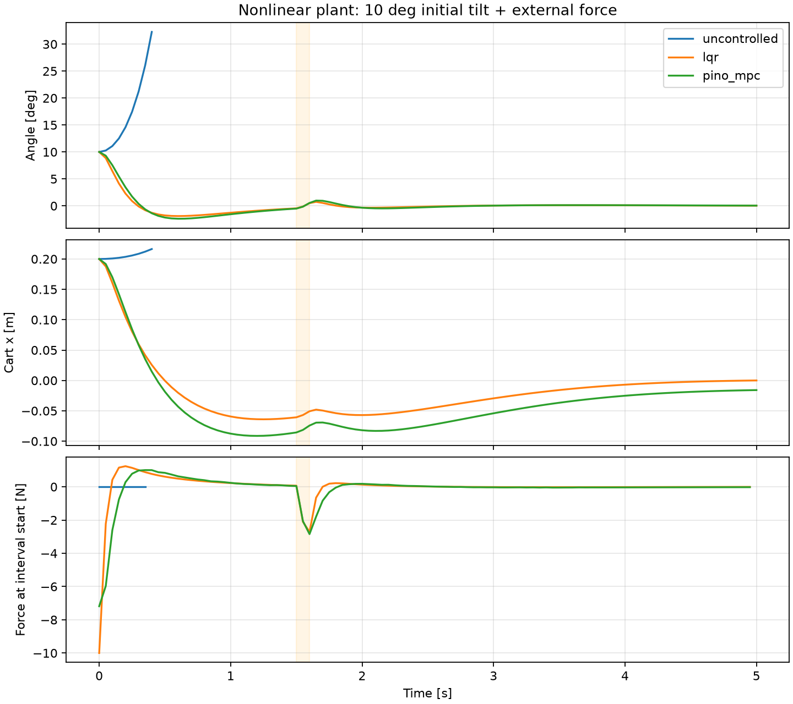
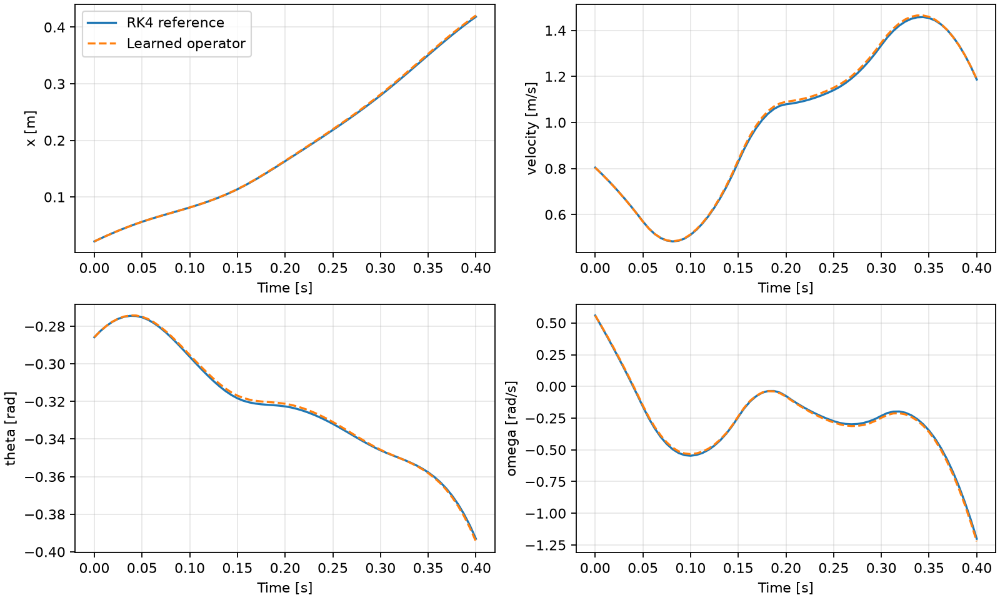

# 実行結果: 2026-10-22

Python 3.12.10 / PyTorch 2.12.1 / CPU。学習シード0、各1500更新。以下はこの環境で実行して得た値であり、設計上の期待値ではない。

## 予測器

同じ512件の学習入力、64件の検証入力、64件の未使用テスト入力を使った。検証誤差で保存ステップを選び、テスト誤差は選択後に計算した。

| 指標 | PINO (物理損失あり) | FNO (物理損失なし) |
|---|---:|---:|
| 保存ステップ | 1350 | 1450 |
| 学習時間 [s] | 19.6338 | 20.0683 |
| 65点の状態RMSE (無次元化後) | 0.00452091 | 0.00929559 |
| 129点の状態RMSE (無次元化後) | 0.00465858 | 0.00934245 |
| 65点の物理残差RMS (無次元) | 0.0195811 | 0.174081 |

物理残差は学習に使ったものと同じ定義を別入力上で計算している。これだけで別の物理量や制御性能の優位性を示したことにはならない。

| 状態ごとのテストRMSE | PINO | FNO |
|---|---:|---:|
| 台車位置 [m] | 0.00108744 | 0.00241776 |
| 台車速度 [m/s] | 0.00784703 | 0.0187922 |
| 角度 [rad] | 0.00386759 | 0.00482353 |
| 角速度 [rad/s] | 0.0311679 | 0.0667343 |

## 閉ループ制御

初期位置0.2 m、初期角度10度、初期速度・角速度ゼロ。5秒間、1.5〜1.6秒に追加外力2 N。目標は位置・角度・速度・角速度すべてゼロ。予測時間0.4秒、制御間隔0.05秒。

| 方式 | 全区間の倒立維持 | 終端の収束判定 | 実行時間 [s] | 最終位置 [m] | 最終角度 [deg] | 最大操作力 [N] |
|---|---|---|---:|---:|---:|---:|
| uncontrolled | 失敗 | 不合格 | 0.40 | 0.216378 | 32.2734 | 0.0000 |
| lqr | 成功 | 合格 | 5.00 | 7.10577e-06 | 0.0350924 | 10.0000 |
| pino_mpc | 成功 | 合格 | 5.00 | -0.0158693 | 0.0454916 | 7.1842 |
| fno_mpc | 成功 | 合格 | 5.00 | -0.0197646 | 0.0456216 | 7.1244 |

無制御は0.4秒で30度を超えて打ち切られた。ほかの3方式は今回の1条件ではどちらの判定も満たした。PINOの予測誤差は小さかったが、制御の成否に差は観測されていない。PINOとFNOの比較はシード0の1学習ずつであり、一般的な優位性は未検証である。

## 計算時間と確認範囲

| 方式 | 平均 [ms/計画] | 95パーセンタイル [ms/計画] | 最大 [ms/計画] |
|---|---:|---:|---:|
| pino_mpc | 24.774 | 22.540 | 399.211 |
| fno_mpc | 23.768 | 21.486 | 399.052 |

初回には最適化器の初期化等も含む。この測定ではPINO/FNOの制御実験を並行して実行している。環境依存の参考値であり、厳密なベンチマークではない。最大時間は制御周期50 msを超える。シミュレーションでは計算時間による遅延を物理系に与えていないため、実時間で制御可能とは確認していない。

5個の整合性チェック（直立と力の符号、陰的運動方程式との一致、無入力時のエネルギー保存、LQRの局所安定性、積分構造の初期状態と制御勾配）は成功した。

学習範囲外、複数シード、初期状態の網羅的な成功率、実機、パラメータ差、観測ノイズ、振り上げ、状態制約付きMPCは未検証。LQRの終端コストを使う点を含め、構成と判定の定義は [README](README.md) を参照。

生の結果は `outputs/pino/training.json`、`outputs/fno/training.json`、`outputs/control/control.json`、`outputs/fno_control/control.json` に保存した。各NPZに軌道・操作力・計画時間を保存している。
