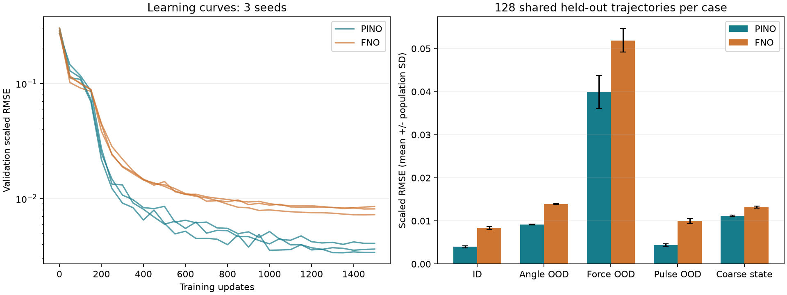
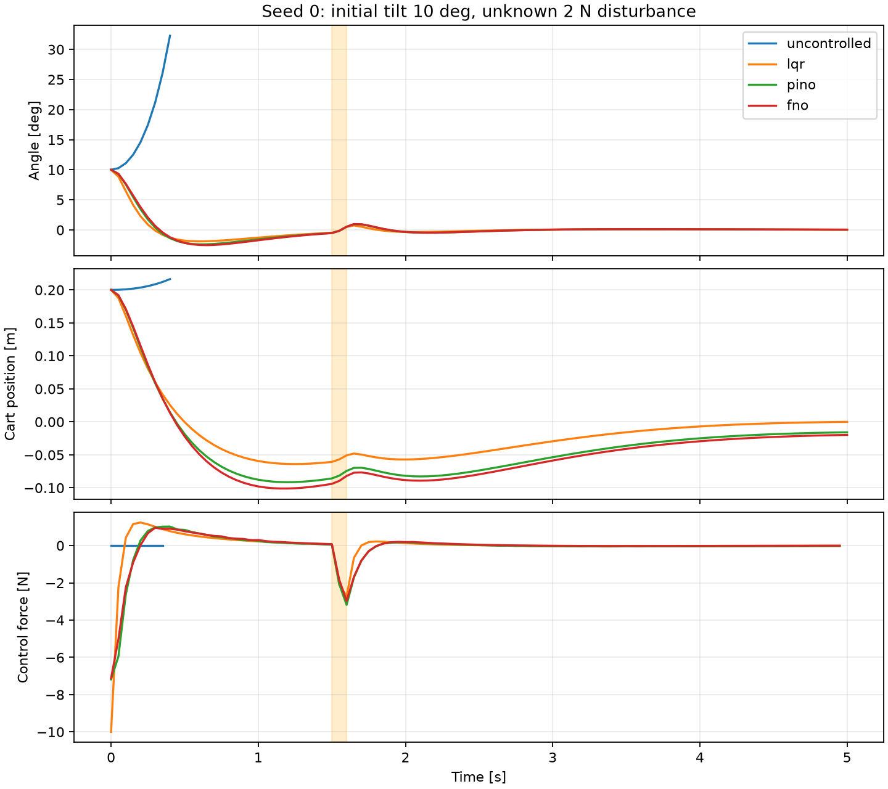
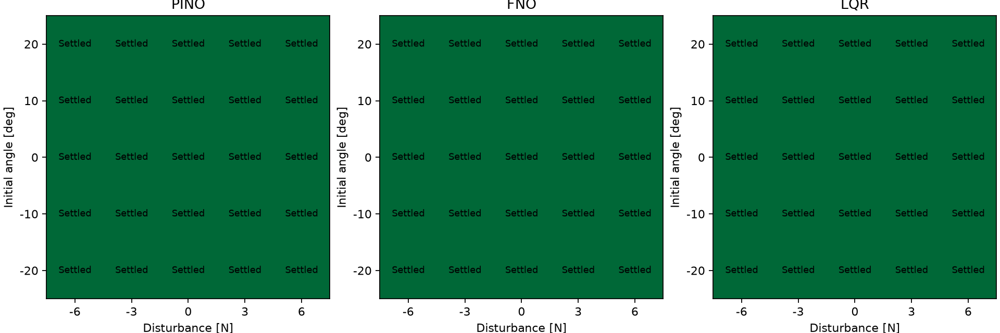

# 倒立振子PINO：初回学習・評価結果（2026-10-22）

学習範囲内の未使用128条件では、PINOの無次元RMSEは平均 **0.004019**、物理残差なしのFNOは **0.008375**。PINOの誤差が **52.0%小さい**結果でした。3学習シードのそれぞれでPINOが改善しています。

これは物理モデルを組み込んだ予測器の学習実験です。操作力は、固定した学習済み予測器を使うMPCが別途最適化します。操作方策を直接学習したものではありません。スライドはまだ作成していません。

## 学習条件

- 台車1 kg、振子0.1 kg、長さ0.5 m、重力9.81 m/s²。摩擦なしの非線形モデル。
- 入力：初期状態 [位置, 速度, 傾き, 角速度] と0.4秒間の力の波形。出力：同区間の状態軌道。
- 初期状態の学習範囲：位置±0.4 m、速度±1 m/s、傾き±0.3 rad（約17.2度）、角速度±1.5 rad/s。力は9節点で各±10 N、節点間は線形補間。
- 512軌道で学習、64軌道でモデル選択。1,500更新、バッチ32。乱数シード0/1/2。シードごとに同じ初期重み・データ・バッチ列でPINO/FNOを対にした。
- 予測は65時点、教師データの損失は17時点、物理残差は65時点。FNOの幅32、周波数モード12、3層。
- 両者に初期条件と積分構造を共通に組み込み、比較する差は物理残差の重み（PINO=1、FNO=0）。FNO側にも構造上の物理的事前知識はある。
- データ損失：状態誤差を [l, √(gl), 1, √(g/l)] で割ったMSE。物理損失：予測加速度と運動方程式から求めた加速度との差を [g, g/l] で割ったMSE。
- 共通評価用の128条件は別乱数90210等で生成し、全モデルへ同じ条件を入力。モデル選択・再学習には使わない。
- 環境：Python 3.12.14、PyTorch 2.12.1+cpu、Windows CPU・2スレッド。比較実験は順番に実行。

| シード | PINO学習時間 | FNO学習時間 | PINO採用更新 | FNO採用更新 |
|---|---:|---:|---:|---:|
| 0 | 18.9秒 | 19.6秒 | 1350 | 1450 |
| 1 | 19.1秒 | 18.9秒 | 1400 | 1450 |
| 2 | 19.1秒 | 17.9秒 | 1350 | 1400 |

## 予測と分布外評価

共通の未使用条件に対する学習前のRMSEは **0.295542**。この初期モデルは加速度出力がゼロなので、初期速度のまま進む予測です。

数値は3シードの平均±標準偏差（ddof=0）。RMSEは4状態と65時点を平均した無次元量で、百分率の誤差ではありません。

| 評価条件（各128軌道） | PINO | 物理残差なしFNO |
|---|---:|---:|
| 学習範囲内の未使用条件 | 0.004019 ± 0.000237 | 0.008375 ± 0.000337 |
| 初期傾き20〜25度 | 0.009175 ± 0.000105 | 0.013926 ± 0.000073 |
| 力の節点振幅10〜16 N | 0.039944 ± 0.003860 | 0.051908 ± 0.002737 |
| 短いパルス波形 | 0.004403 ± 0.000279 | 0.010031 ± 0.000559 |
| 初期状態を粗く丸める | 0.011132 ± 0.000197 | 0.013188 ± 0.000249 |

学習範囲内での傾きのRMSEは、PINO平均 0.213度、FNO平均 0.280度でした。
同条件の無次元物理残差RMSはPINO 0.01540、FNO 0.21346でした。

分布外でも今回の比較では改善が残りました。ただし強い力では両者とも誤差が増え、任意の分布外入力への保証にはなりません。パルスは65時点で表現し、端は1セル（6.25 ms）で立ち上げ・立ち下げる近似です。真の不連続入力や観測格子より短い衝撃への検証は含みません。

粗い初期状態の予測は、丸める前の真の状態から始まる軌道との比較です。観測誤差とモデル誤差の合計を含みます。



## 倒立維持

初期位置0.2 m・傾き10度、速度0。1.5〜1.6秒に台車へ2 Nの外力。5秒間のシミュレーション。基本実験では外力を制御器へ事前に教えず、状態観測から立て直します。

MPCの予測時間0.4秒、操作更新50 ms、操作力±10 N、LBFGS最大15反復。Q=diag(4,1,80,2)、R=0.1、終端重みは局所LQRのP。

倒立維持は全区間で傾き±30度以内・位置±2.4 m以内。終端収束は加えて位置±0.1 m、速度±0.1 m/s、傾き±2度、角速度±0.1 rad/s未満。

| 方法 | 倒立維持 | 終端収束 |
|---|---:|---:|
| uncontrolled | 0/1 | 0/1 |
| lqr | 1/1 | 1/1 |
| pino | 3/3 | 3/3 |
| fno | 3/3 | 3/3 |

学習モデルの状態予測を実測扱いせず、独立したRK4数値積分で実際の状態を進めています。



[PINOの動作GIF](evaluation/pino_control.gif)

## 粗い情報による制御

seed 0・同じ基本初期条件。観測を位置1 cm、速度0.05 m/s、角度1度、角速度0.1 rad/s刻みへ丸めました。この実験では現在の外力推定値を受け取り、予測区間で一定と仮定します。将来のパルス開始・終了は渡しません。推定バイアスはパルス外にも加わります。

| 方法 | 外力推定バイアス | 倒立維持 | 終端収束 | 終端位置 |
|---|---:|---|---|---:|
| pino | -1 N | 成功 | 未達 | -0.262 m |
| fno | -1 N | 成功 | 未達 | -0.306 m |
| pino | +0 N | 成功 | 成功 | 0.008 m |
| fno | +0 N | 成功 | 成功 | -0.016 m |
| lqr | 不使用 | 成功 | 成功 | 0.011 m |
| pino | +1 N | 成功 | 未達 | 0.328 m |
| fno | +1 N | 成功 | 未達 | 0.334 m |

基本実験と粗い情報の実験では外力情報の有無も変わります。粗さだけの効果を切り分ける完全な要因比較ではありません。推定バイアスがある場合、倒立維持と原点への収束を区別する必要があります。

## 初期傾き・外力の25条件

seed 0。傾き −20/−10/0/10/20度 × 外力 −6/−3/0/3/6 N。位置0.2 m、正確な状態観測、外力は未知。他の条件は基本実験と同じ。

| 方法 | 倒立維持 | 終端収束 |
|---|---:|---:|
| pino | 25/25 | 25/25 |
| fno | 25/25 | 25/25 |
| lqr | 25/25 | 25/25 |

±20度は学習初期角度の範囲外です。他の条件でも途中の状態が学習範囲外へ出る可能性があるため、観測状態の範囲外割合・最適化後の合力候補の最大値・実際の合力の最大値をJSONに記録しています。最適化途中の全候補の範囲は集計していません。



## 計算時間

PINOの0.4秒軌道の推論単体は、ウォームアップ10回後・100回計測の中央値が各シードで約 1.51/1.50/1.49 msでした。

以下は基本条件のMPC全体。ウォーム値は最初の制御呼び出しを除外した99回から計算。

| 方法・シード | 初回 | 中央値 | 95%点 | 最大 | 50 ms超過率 |
|---|---:|---:|---:|---:|---:|
| pino 0 | 1332.3 ms | 72.1 ms | 83.6 ms | 87.2 ms | 100.0% |
| fno 0 | 63.5 ms | 75.1 ms | 83.3 ms | 92.1 ms | 100.0% |
| pino 1 | 67.3 ms | 64.2 ms | 83.0 ms | 88.0 ms | 84.8% |
| fno 1 | 57.9 ms | 71.4 ms | 84.4 ms | 88.7 ms | 99.0% |
| pino 2 | 72.1 ms | 74.5 ms | 83.0 ms | 87.7 ms | 100.0% |
| fno 2 | 59.4 ms | 71.7 ms | 80.1 ms | 87.9 ms | 100.0% |

予測は速くても、操作決定には最適化の反復が必要です。今回のMPCは50 ms周期を安定して満たしていません。計算遅延を物理シミュレーションに入れていないため、この倒立成功を実時間制御の成功とは扱えません。

## 検証と残る範囲

- 保存した90制御試行の状態が有限で、操作力が±10 N以内であることを確認。
- RK4の内部刻みを半分（10→20分割）にし、各観測状態から1制御区間を再積分。最大状態差 [m, m/s, rad, rad/s] は 8.54e-11, 7.05e-10, 2.44e-09, 6.60e-09。
- さらに操作を毎回最適化し直す閉ループで12試行を再実行：基本条件のPINO/FNO各3シード、（−20度, −6 N）・（20度, 6 N）のPINO/FNO/LQR各1試行。倒立維持・終端収束の判定は全12試行で一致した。
- 保存操作だけを5秒間再生する別チェックでは状態差が増幅した（最大角度差 5.01 rad）。不安定な倒立振子で観測フィードバックを外した再生は閉ループの精度判定にならないため、上記の1区間比較と閉ループ再実行を用いた。生の再生差も checks.json に残してある。
- 既存の物理整合性テスト5件が通過（平衡・力の符号、運動方程式、エネルギー保存、局所LQR安定性、積分構造と入力勾配）。
- 学習範囲内だけでなく、今回の分布外予測でも物理残差ありの方が良好。ただしこの事実だけで制御成功率や計算速度の優位性は主張しない。
- 数値モデルMPCとの比較、粗い情報の9条件×要因別比較、全3シードでの25条件制御、遅延を含む制御、未知の質量・摩擦は未実施。今回は初回学習の確認に絞った。

## 保存物と再実行

- 各 `pino_seed*/`・`fno_seed*/`：選択した重み `model.pt`、全学習ログ `training.json`、各シードの未使用データ予測。
- `evaluation/`：共通評価データ・全モデルの予測・各制御軌道のNPZ、集計JSON、図とGIF。
- `environment.txt`：実行環境のパッケージ一覧。過去の `outputs/pino` 等は上書きしていない。

プロジェクトルートで次を実行すると、新しい出力先に同じ設定で学習・評価する。

```powershell
.\Example\cartpole_pino\run_trial.ps1
```
